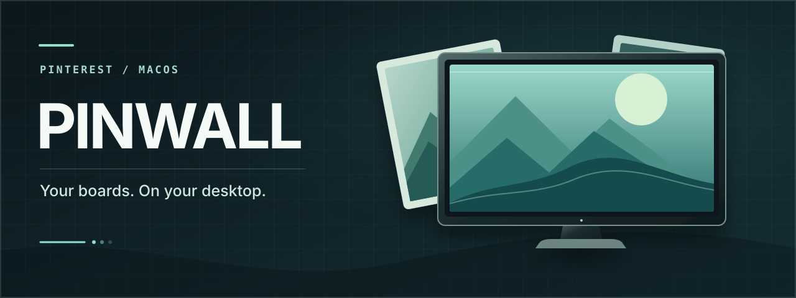

# Pinwall

**Your Pinterest boards, on your Mac.**

Pinwall turns public Pinterest boards into a changing macOS wallpaper. Choose the images you already collect; Pinwall fetches them, renders them for your displays, and keeps the rotation moving in the background.

No Pinterest login or API key required. Just a public board and a little room on your desktop.

[Quick start](#quick-start) · [Controls](#controls) · [Commands](#commands) · [Configuration & reference](docs/reference.md) · [Integrations](docs/reference.md#menu-bar-and-raycast)

---

## Made for the way you collect

**Set a rhythm.** A `launchd` agent changes the wallpaper every 15 minutes and checks your boards every 24 hours by default. New pins join the rotation; favorites appear more often.

**Make it fit.** Each display gets a render sized for it. Browse a preview, adjust crop focus and framing, or show different pins on different displays. Source images can still be smaller than your screen.

**Keep control.** Pause, skip, favorite, ban, or rotate from the terminal. Optional SwiftBar/xbar and Raycast integrations put the same actions closer at hand.

## Quick start

**You'll need:** macOS, Python 3.9+, and at least one public Pinterest board. The requirements file installs `requests` and Pillow.

```sh
git clone https://github.com/Dakuaisu/pinterest-wallpaper-macos.git ~/PinterestWallpaper
cd ~/PinterestWallpaper

python3 -m venv .venv
.venv/bin/pip install -r requirements.txt

cp config.example.json config.json
```

Open `config.json` and replace the placeholder in `boards` with your public board URL. Then:

```sh
./pw doctor     # check setup
./pw refresh    # fetch pins
./pw next       # set the first wallpaper
./pw install    # start the background agent
```

The last two commands change your desktop and install a per-user `launchd` agent, respectively. Re-run `./pw install` after changing `interval_minutes`; use `./pw uninstall` to remove the agent. For alternate Python setup and installation details, see the [installation reference](docs/reference.md#install).

## Controls

Open the keyboard-driven control center from the project directory:

```sh
./pw tui
```

Browsing changes the preview, **not** your desktop. The control center needs an interactive terminal of at least 36 columns by 10 rows for its full view.

| Key | Action |
| --- | --- |
| `↑` `↓` or `k` `j` | Browse wallpapers |
| `Enter` | Apply the selected wallpaper and save its adjustments |
| `Space` | Toggle favorite |
| `r` / `f` / `c` | Rotate / edit framing / edit crop focus |
| `s` | Save the selected pin's staged adjustments without applying |
| `/` / `*` | Search / show favorites only |
| `b` / `+` | Manage boards / add a board |
| `?` / `q` | Keyboard help / leave the view or quit |

In the focus and framing editors, `Enter` stages the edit and `Esc` cancels that editing session. Back in the browser, use `s` to save or `Enter` to apply. The [complete controls guide](docs/reference.md#pinwall-control-center) covers display previews, framing modes, terminal image support, and draft behavior.

## Commands

Use these from the project directory; `./pw tui` is optional.

```sh
./pw next          # next wallpaper
./pw prev          # previous wallpaper
./pw shuffle       # reshuffle and advance
./pw pause 30m     # pause for 30 minutes
./pw resume        # resume automatic changes
./pw fav           # toggle favorite
./pw ban           # ban current pin and advance
./pw rotate cw     # rotate current pin clockwise
./pw status        # boards, displays, agent
./pw refresh       # re-read boards
```

Omit the duration from `./pw pause` to pause indefinitely. See the [full command reference](docs/reference.md#commands) for display targeting, unbanning, opening a pin, orientation, diagnostics, and agent management.

## Good to know

- **Offline:** downloaded images remain available; an offline refresh is not treated as evidence that a board or its pins disappeared. Pinwall retries on the next tick. See [how refresh works](docs/reference.md#how-it-works).
- **Orientation:** optional local model predictions can abstain and are not proof of intended orientation. The [setup and verification guide](docs/reference.md#automatic-orientation-optional) includes the pinned model's size and SHA-256, preview, scanning, and manual overrides.
- **Pinterest and image rights:** boards must be public, and Pinterest's undocumented page format may change. Images belong to their respective owners; this is a personal wallpaper tool, not a redistribution service. See the [caveats](docs/reference.md#caveats).

---

[Full reference](docs/reference.md) · [Configuration](docs/reference.md#configuration) · [License: MIT](LICENSE)
